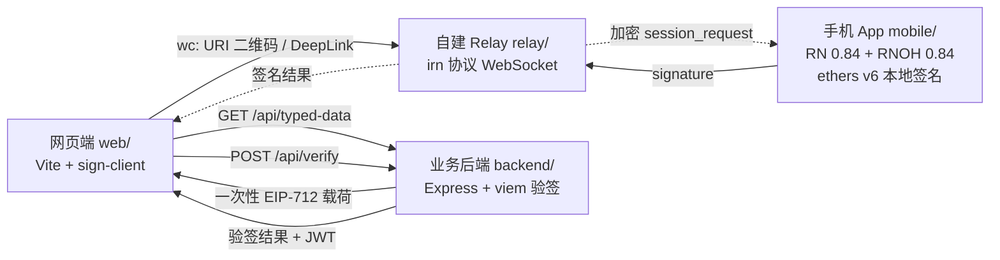

# EIP-712 手机钱包签名 — 闭环最小工程

网页端发起 EIP-712 结构化数据签名请求 → 自建 WalletConnect Relay 转发 →
自研手机 App（iOS / Android / 鸿蒙）本地签名 → 签名回传网页端 → 上送业务后端验签。

私钥自始至终保存在手机端安全存储中，Relay 只转发端到端密文。

## 架构总览



## 目录结构

| 目录 | 角色 | 技术栈 |
|---|---|---|
| `relay/` | 自建 WalletConnect v2 Relay（开发/测试用） | TypeScript + ws，Docker 可选 |
| `backend/` | 业务后端：下发待签载荷、验签 | Express + viem |
| `web/` | 网页 DApp：二维码、发起签名、上送后端 | Vite + @walletconnect/sign-client |
| `mobile/` | 自研钱包 App（钱包端角色） | React Native + ethers + sign-client |
| `docs/` | 架构与鸿蒙接入文档 | Markdown + Mermaid |

## 端口规划

| 服务 | 端口 |
|---|---|
| Relay | 8787（`ws://localhost:8787`） |
| Backend | 3000（`http://localhost:3000`） |
| Web (Vite) | 5173（`http://localhost:5173`） |
| Metro | 8081 |

## 快速启动（按顺序）

```bash
# 1. 启动 Relay
cd relay && npm install && npm run dev

# 2. 启动后端
cd backend && npm install && npm run dev

# 3. 启动网页
cd web && npm install && npm run dev
# 浏览器打开 http://localhost:5173

# 4. 启动手机 App（iOS / Android）
cd mobile && npm install
npm run ios      # 或 npm run android
# 鸿蒙见 mobile/harmony/README.md
```

## 端到端验证步骤

1. 手机 App 首次启动 → 自动生成钱包，显示地址（测试用，可在 App 内查看私钥）。
2. 网页端点击「连接钱包」→ 显示 WalletConnect 二维码。
3. App 点击「扫码配对」扫描二维码（同设备调试可用 Deep Link / 粘贴 URI）。
4. App 弹出会话请求 → 批准；网页端显示已连接地址。
5. 网页端点击「请求 EIP-712 签名」→ App 弹出结构化数据 → 确认签名。
6. 网页端拿到签名并自动 POST 后端 → 后端恢复地址、比对、核销 nonce → 返回验签结果。

## 生产化待办（Demo 中已留接口）

- Relay：本工程 Relay 为最小实现，生产环境建议换社区实现（bitvora/wallet-relay、Shugur-Network/relay）或官方公共 Relay。
- 后端 nonce 存储：Demo 用内存 Map，生产换 Redis（`backend/src/nonceStore.ts`）。
- 私钥存储：iOS Keychain / Android Keystore 已接入；鸿蒙走 HUKS，见 `mobile/harmony/README.md`。
- 合约钱包（EIP-1271）：后端验签改用 viem `verifyTypedData`。
