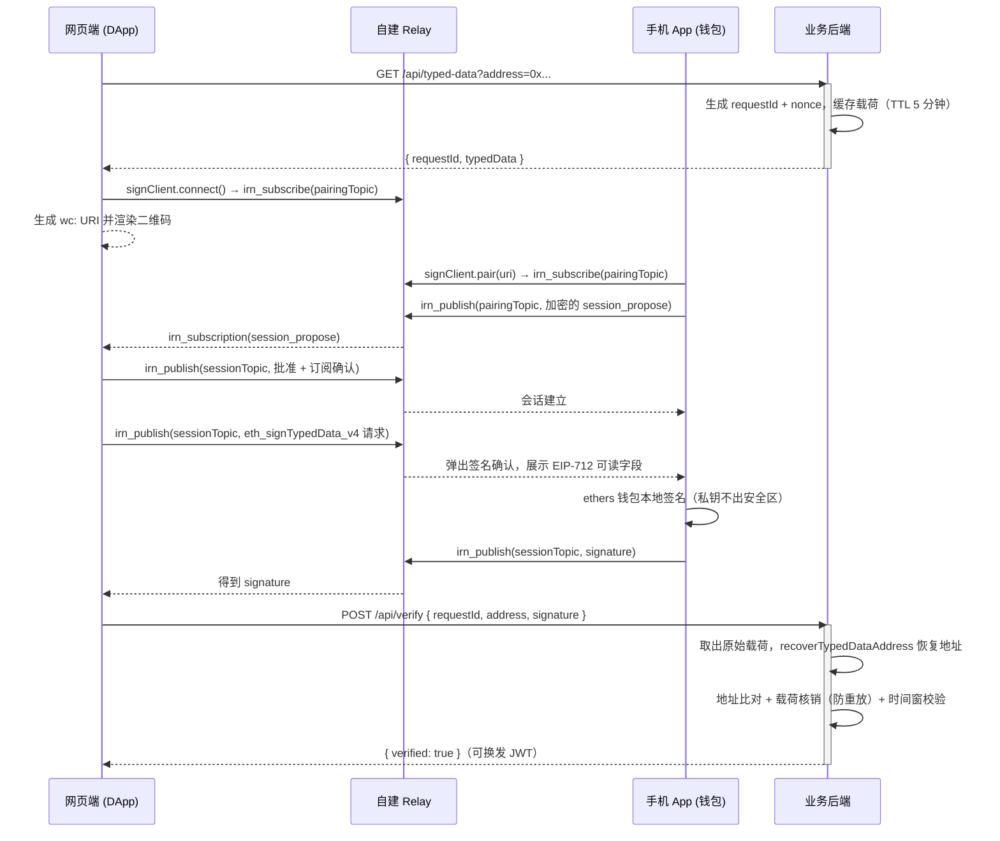

# 架构与协议说明

## 完整时序



## 关键设计决策

### 1. 为什么移动端选 React Native 而不是 Flutter

| 维度 | React Native (RNOH) | Flutter (Flutter-OH) |
|---|---|---|
| 鸿蒙适配 | RNOH 0.84 正式版，对齐 RN 0.84 | Flutter-OH 3.41，滞后上游约 4 个月 |
| WalletConnect SDK | 官方 `@walletconnect/sign-client` 直接支持 RN | 仅有社区第三方实现，协议兼容性无保障 |
| EIP-712 / secp256k1 | ethers v6 内置，纯 JS 实现三端一致 | web3dart 支持弱，Typed Data 常需自行拼装 |
| 鸿蒙 secp256k1 | 纯 JS 计算，不依赖系统密码库 | 同样需自行实现，无收益 |

鸿蒙系统的 HUKS / cryptoFramework 不支持 secp256k1（仅 NIST 曲线、X25519、SM2），
因此签名算法必须用纯 JS 的 @noble/secp256k1（ethers 已内置）；HUKS 仅用于**加密保管私钥 blob**。

### 2. 自建 Relay 的互操作边界

- WalletConnect 配对 URI（EIP-1328）只携带 Relay 协议标识 `irn`，不带服务器地址。
- 第三方钱包（imToken、MetaMask 等）只会连其内置的官方 Relay，**不会连自建 Relay**。
- 因此本方案要求 App 与网页两端都显式配置同一个 `relayUrl`，仅适用于闭环（自研 App）场景。
- 若改用官方公共 Relay，把两端 `relayUrl` 改为 `wss://relay.walletconnect.com` 并配置 Project ID 即可。

### 3. EIP-712 载荷结构（Demo）

```jsonc
{
  "domain":  { "name": "EIP712 Mobile Demo", "version": "1", "chainId": 1 },
  "primaryType": "Verification",
  "types": {
    "EIP712Domain": [],
    "Verification": [
      { "name": "wallet",    "type": "address" },
      { "name": "nonce",     "type": "uint256" },
      { "name": "issuedAt",  "type": "uint256" },
      { "name": "expiresAt", "type": "uint256" },
      { "name": "scope",     "type": "string" }
    ]
  },
  "message": {
    "wallet": "0x...",
    "nonce": "随机数",
    "issuedAt": 1727...,
    "expiresAt": 1727...+300,
    "scope": "auth.login"
  }
}
```

业务场景中，把 `scope` 换成操作类型、把业务参数哈希放进 message，即可让签名与具体请求绑定。

## 安全清单

- [x] nonce 一次性，验签后立即核销；载荷 5 分钟过期
- [x] 待签载荷由后端生成，前端只负责展示与传输
- [x] domain（name/version/chainId）固定，防跨站挪用
- [x] 私钥存入系统安全区（Keychain / Keystore / HUKS），不落地明文
- [x] 仅使用 EIP-712，不使用已废弃的 `eth_sign`
- [ ] 生产环境全站 HTTPS / WSS
- [ ] 生产环境 nonce 换 Redis；Relay 加监控与限流
- [ ] 如需支持智能合约钱包，验签走 EIP-1271
